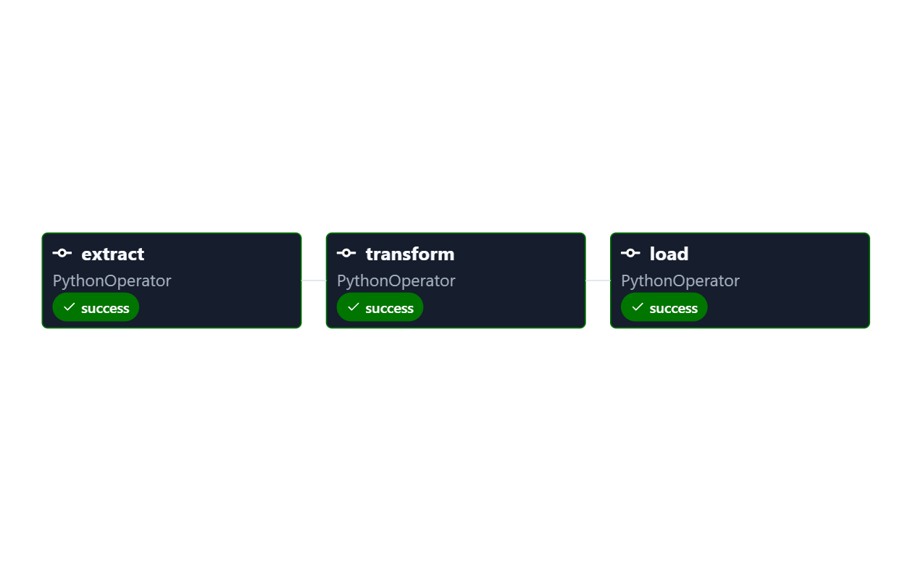

# 📦 Daily Orders Report — Airflow ETL Project

A simple **ETL pipeline** built with **Apache Airflow** that runs every day to count how many orders were placed, validate the data, and save a summary into a PostgreSQL database.

Everything runs inside **Docker**, so no manual installation of Airflow is needed.

---

## 🗂️ Project Structure

```
airflow-project/
├── .github/
│   └── workflows/
│       └── ci.yml            # GitHub Actions CI pipeline
├── dags/
│   ├── daily_orders_report.py # Main ETL DAG (the pipeline logic)
│   ├── ETL airflow .py        # Original ETL DAG (legacy)
│   └── my_first_dag.py        # Simple demo DAG
├── tests/
│   └── test_dag_imports.py    # Validates all DAGs load without errors
├── logs/                      # Airflow task logs (auto-generated)
├── plugins/                   # Custom Airflow plugins (empty for now)
├── config/                    # Airflow configuration files
├── docker-compose.yaml        # Spins up all services with Docker
├── .env                       # Your environment variables (secret keys, UID)
├── .env.example               # Template for the .env file
└── .gitignore
```

---

## 💡 What Does This Project Do?

Every day at midnight, the pipeline runs **3 steps in order**:

```
extract  ──►  transform  ──►  load
```

| Step          | What it does |
|---------------|--------------|
| **Extract**   | Connects to PostgreSQL, counts how many orders were placed **today**, and returns the number |
| **Transform** | Validates that the count is not negative (basic data quality check) |
| **Load**      | Inserts (or updates) the daily summary into the `daily_orders_summary` table |

### DAG Graph (from Airflow UI)



---

## 🐘 Database Tables Used

### Source Table (already exists in your DB)
```sql
"Orders" (OrderDate, ...)
```

### Destination Table (must be created once)
```sql
CREATE TABLE IF NOT EXISTS public.daily_orders_summary (
    report_date  DATE PRIMARY KEY,
    total_orders INTEGER,
    loaded_at    TIMESTAMPTZ
);
```

> The pipeline uses `ON CONFLICT` so running it twice on the same day safely **updates** instead of duplicating the row.

---

## ⚙️ Tech Stack

| Tool | Purpose |
|------|---------|
| **Apache Airflow 3.3.2** | Workflow orchestration (scheduling + monitoring) |
| **PostgreSQL 16** | Database for both Airflow metadata and your orders data |
| **Redis 7.2** | Message broker for Celery (task queue) |
| **CeleryExecutor** | Runs tasks in parallel using workers |
| **Docker Compose** | Runs everything together in containers |

---

## 🚀 How to Run the Project

### 1. Prerequisites
- [Docker Desktop](https://www.docker.com/products/docker-desktop/) installed and running
- At least **4 GB RAM** and **2 CPUs** available for Docker

### 2. Clone the repo & go into the folder
```bash
git clone <your-repo-url>
cd airflow-project
```

### 3. Set up the `.env` file
Copy the example and generate your own Fernet key:
```bash
cp .env.example .env
```
Then edit `.env` and fill in your values:
```env
AIRFLOW_UID=50000
FERNET_KEY=<your-generated-key>
```
> ⚠️ **Never share or commit your real `FERNET_KEY` to a public repo.** Generate a new one with:
> ```bash
> python -c "from cryptography.fernet import Fernet; print(Fernet.generate_key().decode())"
> ```

### 4. Start all services
```bash
docker-compose up -d
```
This will start: PostgreSQL, Redis, Airflow Scheduler, Airflow Workers, Airflow API Server, and more.

### 5. Open the Airflow UI
Go to → **http://localhost:8181**

| Field | Value |
|-------|-------|
| Username | `airflow` |
| Password | `airflow` |

### 6. Set up the Postgres Connection in Airflow
In the Airflow UI:
1. Go to **Admin → Connections**
2. Click **+** to add a new connection
3. Fill in:
   - **Connection ID**: `postgres_orders_db`
   - **Connection Type**: `Postgres`
   - **Host**: your PostgreSQL host
   - **Database**: your orders database name
   - **Login / Password**: your credentials
   - **Port**: `5432`

### 7. Create the destination table
Run this SQL in your orders database:
```sql
CREATE TABLE IF NOT EXISTS public.daily_orders_summary (
    report_date  DATE PRIMARY KEY,
    total_orders INTEGER,
    loaded_at    TIMESTAMPTZ
);
```

### 8. Enable & trigger the DAG
1. Find the DAG **`daily_orders_report_byadel`** in the UI
2. Toggle it **ON**
3. Click **Trigger DAG** to run it manually, or wait for midnight for it to run automatically

---

## 🔄 DAG Details

| Property | Value |
|----------|-------|
| **DAG ID** | `daily_orders_report_byadel` |
| **Schedule** | `@daily` (runs every day at midnight) |
| **Start Date** | October 1, 2026 |
| **Catchup** | `False` (won't backfill missed days) |
| **Retries** | 2 retries with 1-minute delay between them |
| **Tags** | `postgres`, `orders`, `report` |

---

## 🛑 How to Stop Everything

```bash
docker-compose down
```

To also **delete all data** (the Postgres volume):
```bash
docker-compose down -v
```

---

## 🐛 Troubleshooting

| Problem | Solution |
|---------|----------|
| UI not loading on port 8181 | Wait ~2 minutes for services to fully start |
| DAG fails on `extract` | Check that the `postgres_orders_db` connection is correctly configured in Airflow |
| `ValueError: total orders cannot be negative` | The `Orders` table returned a bad value — check the source data |
| Not enough memory warning | Increase Docker Desktop memory to at least 4 GB |

---

## 📝 Notes

- All task communication (Extract → Transform → Load) uses **XCom**, Airflow's built-in way to pass small data between tasks.
- Timestamps in the database are stored in **Africa/Cairo** timezone.
- The Celery **Flower** monitoring dashboard can be started optionally:
  ```bash
  docker-compose --profile flower up -d
  ```
  Then visit → **http://localhost:5555**

---

## 🧪 Tests & CI

### Running Tests Locally
```bash
pip install apache-airflow pytest
pytest -v
```
This runs the DAG import test to make sure all DAGs in `dags/` load without syntax or import errors.

### GitHub Actions CI
Every push triggers the CI pipeline (`.github/workflows/ci.yml`) which:
1. Sets up Python 3.12
2. Installs Apache Airflow 3.3.2 + providers
3. Runs `pytest -v` to validate all DAGs
